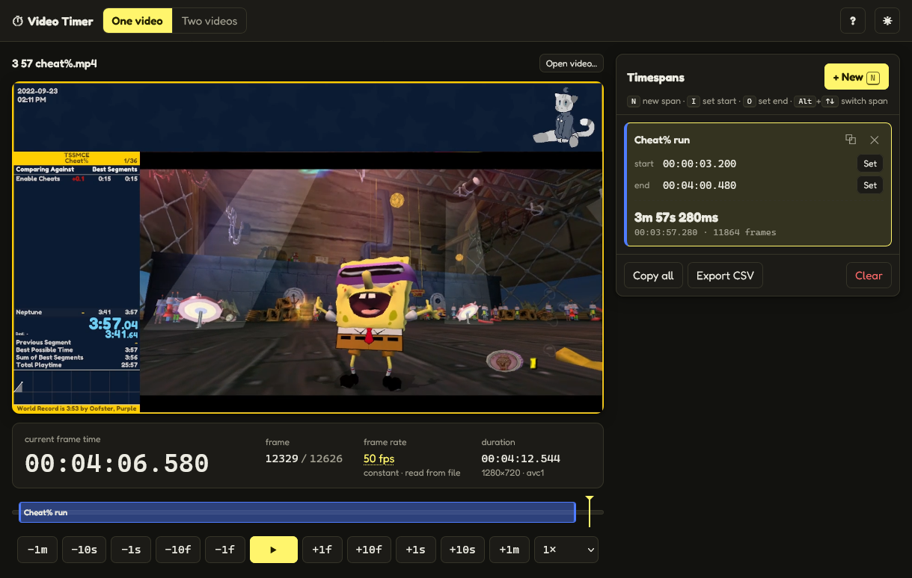

# Speedrun Retimer Tool

Measure time spans in a local video, frame-accurately, entirely in the browser. Useful for retiming speedruns.

**To use:** open `index.html` in Chrome, Edge or Firefox (just double-click it — no server or build step), then drop a video onto the page or click **Open video…**. The controls appear once a video has loaded.

## Features
- Frame-by-frame navigation with a timestamp for the current frame (1 ms precision) and frame number. Click the timestamp to type a time to jump to.
- Click or drag on the timeline to seek; hover it to preview the time.
- Playback speed from 0.25× to 4×.
- Frame rate detection:
  - **MP4 / MOV / M4V**: the container's sample tables are parsed in-browser (`mp4.js`), giving the exact timestamp of every frame — constant *and* variable frame rate video is handled exactly.
  - **WebM / MKV**: the Matroska header (`webm.js`) is read for the declared frame rate, and every cluster is scanned for the exact timestamp of each frame (frame data is skipped, not decoded).
  - **Other formats**: frame rate is estimated by briefly playing the video muted, and snapped to common rates.
  - Click the frame rate to override it manually.
- Named timespans with start, end, duration (`1h 08m 12s 567ms`) and frame count, shown on the timeline. Click a span's start or end to jump to it, or ⧉ to copy its duration.
- Timespans are saved automatically per file (by name and size) in local storage.
- Copy all (tab-separated, pastes into spreadsheets) or export CSV.
- **Two videos side by side** (header toggle or `D`): each panel has its own frame rate, timeline and timespans. Click a panel or press `1` / `2` to choose which one the keys control. **Sync** (`S`) applies frame steps, jumps and play/pause to both videos at once.
- Light / dark themes

## Keyboard shortcuts
| Keys | Action |
|---|---|
| `←` `→` or `,` `.` | Previous / next frame |
| `Shift` + `←` `→` | ±10 frames |
| `J` `L` or `Ctrl` + `←` `→` | ±1 second |
| `↓` `↑` | ±10 seconds |
| `Shift` + `↓` `↑` | ±1 minute |
| `PgDn` `PgUp` | ±10 minutes |
| `Home` `End` | First / last frame |
| `Space` or `K` | Play / pause |
| `G` | Go to time (`1:02:03.456`, `75.5`, or `f1200` for a frame number) |
| `N` | New timespan starting at the current frame |
| `I` / `[` | Set start of active span |
| `O` / `]` | Set end of active span |
| `Shift` + `I` / `O` | Jump to active span's start / end |
| `Alt` + `↑` `↓` | Select previous / next span |
| `F2` | Rename active span |
| `Del` | Delete active span |
| `D` | Toggle one / two videos |
| `1` `2` | Select left / right video |
| `S` | Sync navigation of both videos |
| `T` | Toggle theme |
| `?` | Show shortcuts |

Typical workflow: find the start → `N` → find the end → `O`.

## Notes
- The timestamp shown is the presentation time of the frame's start. A span's duration is `end − start`.
- Which codecs play depends on the browser (e.g. HEVC/H.265 may not play in every browser).
